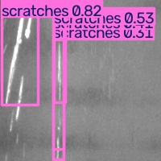
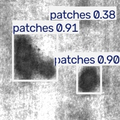
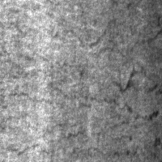
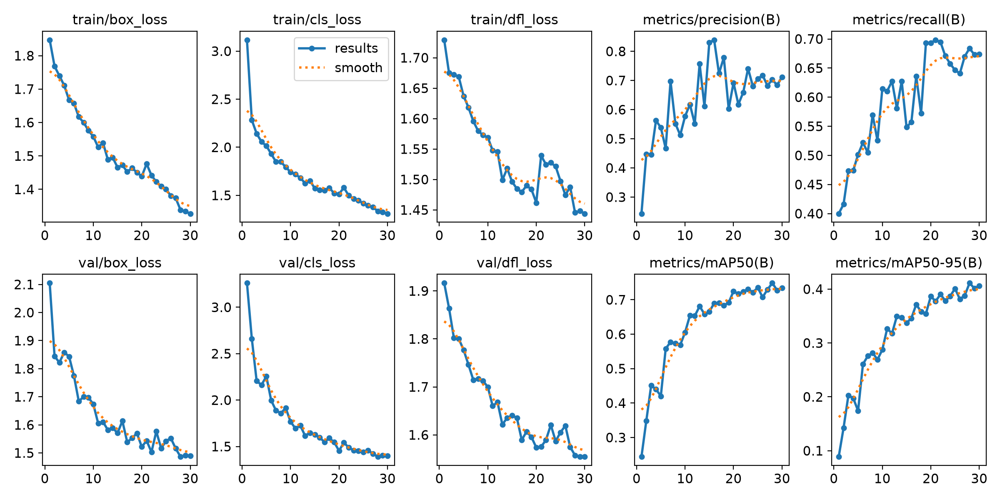

# Steel Defect Detection · 钢材表面缺陷检测

基于 **YOLOv8n + NEU-DET** 的六类钢材表面缺陷检测学习项目，覆盖 XML → YOLO 标注转换、可追溯数据划分、训练预算对比、独立测试及 ONNX Runtime 本地 CPU 推理。

**独立测试 mAP50：72.8% · mAP50-95：42.7% · 六张验证图 ONNX 转换一致性检查通过。**

使用现有检测框架微调，不是原创算法；当前完成本地 CPU 推理验证，未进行嵌入式或生产部署。代码与文档整理使用了 AI 辅助。

## 预测示例

| 划痕 scratches | 斑块 patches | 裂纹 crazing：失败样例 |
|:---:|:---:|:---:|
|  |  |  |

图片为验证集 ONNX 推理结果，conf=0.25。框数量不代表正确检出数；裂纹样例未检出，保留它展示模型局限。

## 实验结果

| 指标 | 10轮验证 | 30轮验证 | 选定模型独立测试 |
|---|---:|---:|---:|
| Precision | 0.767 | 0.704 | 0.679 |
| Recall | 0.572 | 0.685 | 0.696 |
| mAP50 | 0.672 | 0.749 | **0.728** |
| mAP50-95 | 0.360 | 0.411 | **0.427** |

- 训练1260张、验证270张、测试270张；测试集包含633个目标。
- 从 COCO 预训练 `yolov8n.pt` 起点分别训练10/30轮，CPU、imgsz=320、batch=4、seed=42。
- 根据验证集选择30轮运行的 `best.pt`（CSV中第28轮 mAP50-95 最高），随后锁定模型进行独立测试，不用测试集调参。
- 两次运行的默认学习率进程和 Mosaic 生效阶段也随总轮数变化，因此属于**训练预算对比**，不是严格单因素实验。
- 裂纹测试召回率仅18.7%，仍是主要短板；划痕测试 AP50 为94.3%。mAP 不是分类准确率。



完整结果：[测试报告](reports/final_test.json) · [训练CSV](reports/baseline_30epochs.csv) · [测试混淆矩阵](assets/test_confusion_matrix.png)

## ONNX 验证

FP32、opset17、固定 batch1，输入 `1×3×320×320`，输出 `1×10×2100`，置信度筛选和 NMS 在图外执行。

- ONNX 结构检查通过。
- 验证集六类各一张图，原始输出 allclose（rtol=0.001、atol=0.001）全部通过。
- 最终检测类别、框坐标及置信度在设定容差内匹配；这不等于全量 ONNX mAP 评估。
- 最新一次四线程 CPU 测量：PyTorch **20.0ms**，ONNX Runtime **6.8ms**，均为预热后30次纯模型计算的中位数，不含读图、预处理、NMS或绘图。环境为 i7-12700H，结果会随负载变化。

[机器可读核验报告](reports/onnx_verification.json)记录了版本、模型SHA256、逐图误差及测速条件。

## 复现

Python 3.11，以下命令适用于 Windows PowerShell；先克隆仓库并进入根目录。

```powershell
git clone https://github.com/James23172/steel-defect-detection.git
cd steel-defect-detection
py -3.11 -m venv .venv
& ".\.venv\Scripts\python.exe" -m pip install torch==2.7.1 torchvision==0.22.1 --index-url https://download.pytorch.org/whl/cpu
& ".\.venv\Scripts\python.exe" -m pip install -r requirements.txt
```

### 1. 准备数据

数据不随仓库分发。参照[数据来源与协议](docs/DATA.md)下载固定提交镜像，将 `IMAGES`、`ANNOTATIONS`、`Validation_Images`、`Validation_Annotations` 四个目录放在仓库根目录的 `NEU-DET原始镜像/` 下，然后运行：

```powershell
& ".\.venv\Scripts\python.exe" prepare_day14_data.py
```

脚本生成正式数据集和小样本流程检查集，按字节相同图片分组，避免完全重复图片跨集合，并检查4189个框的坐标反算。脚本拒绝覆盖已有数据目录。固定划分见 [split_manifest.json](reports/split_manifest.json)。

### 2. 训练

```powershell
& ".\.venv\Scripts\yolo.exe" detect train cfg=configs/baseline_10epochs.yaml
& ".\.venv\Scripts\yolo.exe" detect train cfg=configs/baseline_30epochs.yaml
```

Ultralytics 会下载预训练 `yolov8n.pt`。配置来自实际运行参数，路径已改为仓库相对路径。重复运行会自动生成带序号的输出目录；后续命令默认使用第一次的 `baseline_30epochs`。原实验训练时将 PyTorch CPU 线程数设为4；CLI默认线程数可能不同，耗时不应直接比较，数值也不保证逐位一致。

### 3. 独立测试与预测

先根据验证集锁定模型，再运行测试；不根据测试结果继续挑选超参数。

```powershell
& ".\.venv\Scripts\yolo.exe" detect val model=day14_runs/baseline_30epochs/weights/best.pt data=steel_defect_dataset/data.yaml split=test imgsz=320 batch=4 device=cpu workers=0 project=day14_runs name=final_test
```

### 4. 导出与核验

```powershell
& ".\.venv\Scripts\python.exe" export_verify_onnx.py
```

输出 `VERIFICATION_PASSED True`，生成 `day14_runs/baseline_30epochs/weights/best.onnx`、六图预测和 JSON 核验报告。会更新本地导出与验证产物；不重新访问测试集。

```powershell
& ".\.venv\Scripts\yolo.exe" detect predict model=day14_runs/baseline_30epochs/weights/best.onnx source=steel_defect_dataset/images/val/scratches_11.jpg imgsz=320 conf=0.25 device=cpu
```

仓库不包含完整数据、模型二进制或虚拟环境；训练后即可导出并运行。已完成实验的摘要、划分清单、曲线与核验结果包含在仓库中。

## 文件导航

| 路径 | 内容 |
|---|---|
| `prepare_day14_data.py` | XML转换、重复图分组、固定划分、坐标校验 |
| `run_day14_smoke.py` | 小样本单轮训练、保存重载及预测检查 |
| `configs/` | 实际10/30轮训练参数的可移植副本 |
| `export_verify_onnx.py` | ONNX导出、结构校验、六图一致性与CPU计时 |
| `reports/` | 实验CSV、测试摘要、数据溯源、划分清单和ONNX报告 |
| `assets/` | 训练曲线、测试混淆矩阵和预测图 |

## 来源与边界

- [Ultralytics](https://github.com/ultralytics/ultralytics) 提供 YOLOv8 实现和预训练权重。
- [NEU-DET 官方页面](https://faculty.neu.edu.cn/songkechen/zh_CN/zdylm/263270/list/)及[固定镜像提交](https://github.com/siddhartamukherjee/NEU-DET-Steel-Surface-Defect-Detection/tree/351bee21b56bbf97a1e1d18262bceb202eb7ef41)提供数据来源。
- 81个 difficult 目标作为普通标注保留，不采用 VOC ignore-difficult 协议；镜像未与官方原包逐一比对，未完成全部近似重复审计。
- [依赖与数据说明](docs/THIRD_PARTY.md)。本项目不授予第三方数据或模型额外使用权。
